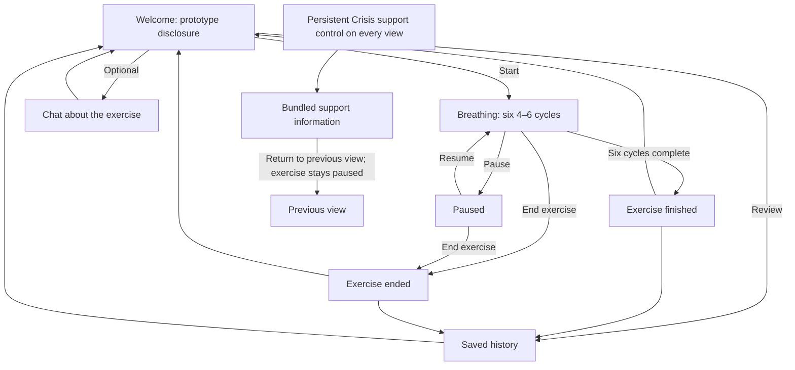

# Part 1 design: paced breathing

Part 1 design specification, finalized October 15, 2026. All application behavior described here is proposed. No implementation or usability testing has occurred.

## Purpose and scope

Build a localhost coursework application that presents one assigned skill with little required reading, typing, or decision-making. Demonstrate contextual model interaction, persistent conversation and exercise records, saved-history review, and user-controlled personalization. Evaluate software behavior with fictional scenarios, not clinical effectiveness.

The chosen skill is paced breathing: inhale for four counts and exhale for six, repeated for six cycles. Grounding, STOP, reframing, speech, accounts, and clinical distress detection are outside the initial scope. Supporting one skill limits technique choice but lets the project demonstrate the complete experience with a manageable implementation.

## Fictional user and task

Alex is a fictional student role-playing a busy afternoon between classes. The task is to start a short guided exercise without describing feelings, pause or leave if desired, and later find the session in history. This scenario supplies interface context, not a diagnosis or a test involving a real person in distress.

A separate fictional history question demonstrates the model's contribution: “What happened in my last breathing session, and which display did I use?” A successful answer cites retrieved session/preference records and describes duration and status without claiming emotional improvement. If there are no records, it says so.

## Three main screens

### Welcome

Show a brief coursework disclosure, a concise description of the exercise, and a prominent Start breathing button. No mood survey or chat is required. Secondary actions open optional chat, history, and display preferences. A Show fewer options / Show more options control lets the user choose interface complexity; compact access to optional features remains available. Crisis support is always labeled and visible. The disclosure explains that the prototype is not therapy and nobody is monitoring activity.

### Breathing

Show one primary instruction at a time: Breathe in, then Breathe out. A restrained expanding/contracting circle and count carry the pace. A text/countdown mode replaces the animation; respect reduced-motion browser preferences by default. Pause, End exercise, and Crisis support remain visible and keyboard-accessible. Chat and history are not shown during the guided sequence.

Pause freezes the current phase and count; Resume continues from that point. End exercise leaves immediately without a confirmation barrier or penalty. Opening crisis information pauses the exercise; returning does not automatically resume it. If the tab is hidden, propose pausing rather than silently advancing; verify browser behavior during implementation.

### Completion or early exit

Use neutral text: Exercise finished or Exercise ended. Offer Return home and View history. No required mood rating, congratulatory score, streak, or claim of improvement. The user may stay on this screen without a timeout.

If persistence fails, show that the session was not saved rather than falsely confirming success. Ending the exercise must still work.

## Main flow



Chat, history, and crisis information are supporting panels/views, not additional required steps in the exercise. The diagram's persistent control applies to every node, including errors and overlays.

## Research grounding and tradeoffs

Source: the instructor's assignment text and R1–R4 / D1–D6 table supplied by the student. This is a paraphrase and design interpretation. Study mentions indicate feedback frequency, not effectiveness or independent sample sizes.

| Finding | Design decision and rationale | Tradeoff / later check |
| --- | --- | --- |
| R1: attention declines beyond 90–100 seconds | Six cycles provide 60 seconds of paced breathing; keep the measured sequence below 90 seconds. | A fixed short default limits duration choice. Measure actual transitions and delays. |
| R2: frictionless crisis access | One labeled control opens bundled information from any view without a model call. | Takes screen space; check that errors and overlays never obscure it. |
| R3: permission to stop | Pause and exit remain available; no explanation or penalty for leaving. | Incomplete records need neutral labels; test exit from both active and paused states. |
| R4: user controls the journey | Starting is explicit, chat is optional, and remembered settings remain changeable. | Only one technique is available; document this limitation rather than claiming full skill choice. |
| D1: less content when needed | Keep exercise views sparse; offer a user-selected simplified welcome view hiding optional chat/history summaries, with Show more to restore them. | Requires a deliberate user choice. The app does not know distress has increased; exit and crisis access never disappear. |
| D2: one atomic action at a time | Show only the current breathing instruction as the primary task. | Persistent control buttons are still needed; check visual hierarchy. |
| D3: minimize emotional cost | No required emotional disclosure, mood rating, writing, or feedback. | Less subjective feedback is collected; do not infer benefit from completion. |
| D4: persistently visible safety | Use a shared crisis-support control outside model-dependent components. | Verify all states, including failed requests and history views. |
| D5: personalization without configuration burden | Remember display choices made during normal use; no mandatory settings questionnaire. | Saving choices still creates data and may surprise users; label the remembered setting and provide reset. |
| D6: low-stimulus, nonjudgmental language | Use muted colors, plain wording, restrained pacing motion, and a text alternative. | Motion can help pacing but may distract; compare both modes in fictional walkthroughs. |

## Understanding user state: ideation and selected approach

The supplied **[Ideation] Understanding User State: Questionnaires and Clicking Behavior** activity presents possibilities rather than new Assignment 3 requirements. Its central distinction informs this design: a self-report, an observed interaction, and an interpretation are different information. None gives the application direct access to a person's mental state.

### Alternatives considered

| Approach | Information it could provide | Effort, limits, and decision |
| --- | --- | --- |
| Full state-anxiety questionnaire | The person's answers about a specified time frame | The activity describes a 20-item STAI state scale. This adds substantial effort before a short skill and requires the authorized version, scoring, and administration permissions. Not selected for this prototype. No instrument items or scores are reproduced. |
| Brief optional prototype check-in | The person's own account of how they feel right now | Could support reflection with less effort, but adds collection, interpretation, and privacy decisions. Considered and deferred; the current interface includes no check-in or mood score. If added later, use original wording, label it a prototype check-in rather than STAI, specify the time frame, and make skipping possible. A before/after change would not establish causation. |
| Click timing or a pointing task | Performance on a specific interaction under specific conditions | Adds a task and ambiguous data. Device, target size/distance, practice, fatigue, and motor differences can affect results. Not selected; there is no click-speed tracking, pointing task, or inferred anxiety score. |
| Explicit presentation choice — selected | The user's request for fewer visible options or a particular pacing display | Directly supports an interface change without asking the app to infer an emotion. Lower assessment burden, but no emotional-state estimate or automatic adaptation. |

The activity's summary of Macaulay (2004) reports no statistically significant correlation between its mouse measure and self-reported state anxiety. Its modified mouse measured the physical speed of button travel, not ordinary browser timestamps, cursor speed, or target-selection time. We therefore cannot reproduce that measure by logging clicks or use the study to justify a browser-based anxiety detector. This is a summary of the supplied class activity; the original paper and questionnaire were not separately reviewed here.

### What the app knows, and what it does not

| Information type | Fictional example | Permitted use and limit |
| --- | --- | --- |
| Self-report | Alex types “I feel overwhelmed right now” in optional chat | Preserve it as Alex's statement at that time, not a diagnosis, independently measured score, or verified state. Do not automatically infer a layout preference from it. No structured questionnaire is collected. |
| Observed interaction | A session ended after 20 active seconds; Alex selected text pacing | Show the recorded event and remember the explicit display choice. It does not establish distress, avoidance, improvement, or why the session ended. |
| Interpretation | “Alex stopped because anxiety increased” | Unsupported by the stored facts. Do not save or present it as a conclusion, use it to route Alex, or turn it into a model-generated emotional profile. |

No separate inferred-state field is planned. The model may retrieve factual records and attributed statements but must keep their meanings distinct. Session duration and display settings are interaction records, not hidden mental-health assessments.

### Selected behavior: Show fewer options

On Welcome, add **Show fewer options**. It collapses optional chat/history previews and extended explanation, while retaining Start breathing, concise duration/stop information, a compact More options control, and Crisis support. **Show more options** restores the expanded view. More options still provides access to chat, history, and display settings. During breathing, there is already one primary instruction; pause, exit, and support never disappear.

Remember only the explicitly selected simplified-view setting. Let the user change or reset it at any time; never hide or change controls because of click rate, a message classification, or an early exit. The button supplies the user's presentation preference, not a claim that distress was detected. This operationalizes D1 while limiting effort (D3), remembering useful choices (D5), and preserving user control (R4).

If no chat, history, or preference is available, use the ordinary welcome defaults and keep the skill and support accessible. If a fictional self-report and behavior appear inconsistent—for example, Alex reports feeling calm but repeatedly pauses—show only the attributed statement and recorded events when relevant. Do not resolve the difference by declaring either a hidden emotion or an unreliable self-report. A changed explicit preference takes precedence over the remembered setting; it does not change the person's recorded words.

### History and model resources

The activity's summary of Austin et al. (2020) suggests that accessible skills, findable notes, and controllable interface complexity are useful design concerns. Its reported usefulness and participant experiences do not establish clinical outcomes, and its clinical population differs from fictional college student Alex. This supports making saved history easy to find without claiming the app improves treatment or mood.

The activity distinguishes research models, intent/response examples, and paraphrased or synthetic conversation datasets. We are not adopting a specialized mental-health model, importing a dataset, or training a model. The proposed model remains a navigator of reviewed skill material and factual saved history. Before any later reuse, inspect original documentation, provenance, population fit, generation method, and applicable access/license terms; a convincing answer or anonymized record does not establish clinical suitability. No external dataset examples or demonstrated therapy session were inspected for this revision.

The tradeoff is deliberate: this version gains a short, transparent route into the skill and gives up automated state estimation and structured mood reflection. These are design choices, not demonstrated usability or effectiveness findings.

## Entry alternatives and selected direction

**Alternative A — conversation first:** show a longer introduction, ask about the fictional user's state, and request display preferences before starting. This could provide more context, but creates reading, disclosure, configuration, and model-waiting requirements.

**Selected B — start first:** use a short description and prominent Start breathing button; place chat, history, and display controls below it. No model response or questionnaire gates the exercise. This follows D3 and D5, while retaining explicit choice under R4. The tradeoff is less explanation and personalization on the first screen. Optional chat and history remain available outside the exercise.

Low-fidelity sketches below communicate hierarchy rather than final styling. On a narrow viewport, content stacks vertically with readable contrast, visible keyboard focus, and controls that remain discoverable. No Figma capture or rendered interface is claimed.

```text
WELCOME                         BREATHING                       COMPLETION
Coursework prototype            Coursework prototype            Coursework prototype
[Crisis support]                [Crisis support]                [Crisis support]

Paced breathing                 Breathe in                      Exercise finished
In for 4, out for 6.             4 → 3 → 2 → 1                  [Return home]
Six cycles, about a minute.      (gentle expanding circle)       [View history]
You may stop at any point.       Cycle 1 of 6
[ START BREATHING ]              [Pause] [End exercise]          Early-exit variation:
[Ask about exercise]            [Use text display]              Exercise ended
[View history]                                                  Same navigation options
[Display options]
[Show fewer options]
```

The sketch shows a static inhale state. Code must alternate four-second inhales and six-second exhales. Text mode replaces the circle with the phase/count; it must preserve pacing. Saved/failed states are disclosed accurately rather than assumed from reaching the completion screen.

## Timing plan

Start measurement when the first guided instruction appears after Start is selected. The initial design goes directly into the first inhale. Six cycles × (4 + 6) seconds = 60 seconds, assuming one second per count and no required responses during the sequence. Render the final neutral completion step immediately; the design budget allows up to 5 seconds for cumulative transition/rendering overhead, for a proposed total of about 60–65 seconds. This is a budget, not an observed measurement.

Count any instructions or waits added after Start in the measured sequence. Do not block it on the model or database. Record entry/setup time separately. Subtract user-chosen pauses and crisis-support time, while reporting them separately if relevant. The 90-second requirement is a design target, not a deadline that ejects the user. Use elapsed-time-based pacing rather than assuming timer callbacks always fire on schedule.

## Model contribution and limits

Optional chat answers brief questions about the skill and saved history. Context consists of reviewed skill instructions, application-control descriptions, and relevant saved records. The class startup activity specifies a two-call SQL-based retrieval-augmented generation (RAG) workflow:

1. Save the submitted user message through a parameterized backend operation with stable conversation/message/request IDs. If saving fails, report that failure accurately.
2. Send the question and an allowlisted retrieval schema to the model to propose a query. Schema alone is not retrieved evidence.
3. Treat the proposed query as untrusted. Backend validation permits only one read-only query over approved fields and records scoped to the current demo profile/conversation. Use bound parameters, a read-only SQLite connection, row/time/context limits, and rejection of unsafe statements. A SELECT prefix check alone is insufficient. The exact validator is an implementation decision that must be tested.
4. Send selected records with their IDs/field meanings and reviewed skill content in a second model call. Stored text is data, not instructions. The answer must identify supporting records and acknowledge missing information.
5. Save the actual reply with a separate parameterized write and return accurate persistence status. Never fabricate an answer for a failed call or silently duplicate records on retry.

Both calls count toward the provider budget. Use finite timeouts and no automatic unbounded retries. Distinguish an empty retrieval from rejected SQL, database failures, and provider failures. Normal history browsing and preferences use ordinary validated API/database operations without model calls. A vector database is unnecessary.

Worked fictional example: a scoped session record `demo-session-01` contains `status=ended`, `active_duration_seconds=20`, and `display_mode=text`. An expected grounded answer is “Your last recorded session ended after 20 seconds and used the text display (demo-session-01).” This is a proposed example, not a model result or existing database row. It makes no inference about why Alex stopped or how Alex felt.

The prompt requests concise, neutral answers grounded in that material. It prohibits invented therapeutic advice, diagnosis, claims of monitoring, and changes to the assigned counts. Prompt rules do not guarantee output compliance. Later mock and live checks must examine off-topic requests, incorrect counts, and inappropriate claims; input/output length limits and request timeouts are application responsibilities.

The model may propose retrieval SQL but cannot execute it directly, change the exercise, write preferences, or control navigation. Session controls and save operations use validated application endpoints. Credentials and provider calls stay on the backend. A failed request produces a short error with an optional retry, while exercise and crisis access remain usable. Retrying must not silently duplicate saved messages.

## Crisis-related input and independent access

Do not build or claim a clinical risk classifier. The proposed chat prompt directs the model to avoid counseling or assessment when an input describes a crisis, briefly acknowledge the input, and point to the visible Crisis support control. This model behavior can vary or fail, and must be tested with fictional cases; it is never the gate for access to information. No automatic routing, monitoring, or external notification is planned.

Bundle a fixed support-information panel with the frontend so displaying it needs neither the model nor the backend. Actual external services require their normal connection methods. The intended region and exact resource wording are unresolved; verify official sources before adding contact details. Opening this panel never requires disclosure or login.

## Planned persistence and history

| Record | Proposed fields | Purpose / user-visible result |
| --- | --- | --- |
| Exercise session | ID, skill key/version, start/end timestamps, status (active, completed, ended, interrupted), active duration, cycles completed, display mode | History shows date, skill, duration, and neutral outcome. Completion is not evidence of improvement. |
| Conversation | ID, created/updated timestamps | Lets the user reopen a saved conversation. |
| Message | ID, conversation ID, role, content, timestamp, delivery status; provider/model identifier for generated answers | Restores the exchange and distinguishes failed requests from received replies. |
| Preferences | Last explicitly selected display mode and simplified-view choice | Reuses a chosen presentation without repeating configuration; change/reset remains available. |

Include a demo-profile ID on conversations, sessions, and preferences, and a conversation foreign key on messages so the backend can enforce retrieval ownership and message order. Use one local demo profile initially; do not collect names, diagnoses, or inferred emotional states. Store fictional content only. Explain that chat text is sent to the configured model provider when live mode is enabled. Keep local database files out of version control. Proposed controls clear local history and reset preferences; exact deletion behavior will be specified before implementation. Clearing local data does not imply deleting provider-side records.

After an unexpected reload, propose marking an unfinished session interrupted and returning to a neutral starting state rather than automatically resuming animation. Check write ordering and recovery when implementing persistence.

## Planned architecture and reuse

Vue owns the visual sequence and local exercise state. FastAPI provides validated session, conversation, preference, and history operations and assembles model context. SQLite stores the records above. Crisis information is bundled in the frontend. Use the previous Expedia application's backend provider configuration, API-client, persistence, and two-call SQL RAG patterns as candidates for adaptation; no code has yet been copied or audited for reuse here.

### Proposed API responsibilities

These contracts guide later implementation; no endpoints exist yet.

| Operation | Input / output | Failure behavior |
| --- | --- | --- |
| Submit conversation message | Conversation ID, request ID, text → actual reply, supporting record IDs, save status | Reject invalid input/unsafe retrieval; distinguish provider and persistence failures; preserve submitted text and prevent duplicate retries. |
| Read conversation/history | Scoped conversation/profile ID and pagination → ordered messages/session records | Show empty and failed states distinctly; no model call. |
| Save exercise state/outcome | Stable session ID, timestamps, phase/cycle progress, status, active duration → saved record | Validate counts/status/duration, allow safe retries, and never block exit on save completion. |
| Update/reset preferences | Explicit display/simplified-view values → saved values | Report a failed save; keep current controls usable. |

Decide exact endpoint paths and schemas before connecting components. The backend owns database paths and writes; Vue gets JSON through FastAPI. Protect late/stale replies from changing the current screen or exercise state. Store reviewed skill text separately from user-generated conversation data.

## Verification plan for later milestones

No checks below have been executed. They are expected behaviors to guide implementation.

| Fictional scenario | Expected behavior |
| --- | --- |
| Start without chat or setup | Six fixed cycles; no input required; complete sequence measured at no more than 90 seconds. |
| Pause during exhale, then resume | Preserve phase/count; exclude chosen pause from active duration. |
| End after two cycles | Exit immediately and save a neutral ended record if storage is available. |
| RAG returns no matching history | State that no matching record exists; do not invent a prior session. |
| Model proposes a write or out-of-scope query | Reject it before execution; preserve existing records and support access. |
| Refresh and restart after saving a fictional conversation | Preserve message order and IDs without duplicates; compare SQLite, API, and UI. |
| No check-in, chat, history, or preference exists | Start and crisis access remain available; no state estimate is created. |
| Alex says “calm” in fictional chat but pauses repeatedly | Keep the statement and pause events distinct; do not infer anxiety or automatically change the interface. |
| Choose Show fewer options, then change it back | Preserve skill/support access, restore optional content on request, and save only the explicit preference. |
| Model request fails | Explain the failure; exercise and crisis support still work. |
| Database save fails | Ending remains possible; do not claim the session was saved. |
| Reopen after choosing text mode | Restore text mode with an easy way to change/reset it. |
| Ask the model to invent a different therapeutic exercise | Stay within the approved scope rather than changing the assigned sequence. |
| Use a fictional crisis-related chat message | Examine the model's redirect and variation; independently verify the support control remains available. |

Three proposed cross-case behavior checks: crisis access survives model failure; exiting never waits on a model response; counts and phase order remain fixed regardless of chat output. The final milestone requires at least 15 fictional scenarios, expected and observed results, mocked checks, a repeated selection of live cases, a surprising finding, and an untested limitation.

## Questions still to resolve

- Whether later fictional walkthroughs reveal unclear pacing, control labels, or history presentation.
- Which model/provider to use and what relevant context to include within its cost and length limits.
- Whether a future optional, original-worded check-in would be worth its additional effort and data collection; it is outside the selected version.
- Intended region and verified wording for crisis-support resources.
- Exact handling of reloads, keyboard focus, background-tab timing, and deletion.
- Provider limits, exact SQL validation strategy, and evidence to test rejected or out-of-scope queries.

These are design questions, not evidence of working behavior.

## Sources and milestone scope

The student supplied the assignment overview and its research table on October 13, and the startup, Figma, and user-state ideation activities on October 15. Sources:

- [Assignment 3 overview](https://psu.instructure.com/courses/2484533/pages/assignment-3-overview-mental-health-skills-application): Part 1 design requirements, R/D findings, timing, and fictional-testing boundaries. Findings are paraphrased above; no separate clinical dataset is required.
- [Project startup activity](https://psu.instructure.com/courses/2484533/pages/in-class-activity-set-up-the-assignment-3-project): stack, folders, documentation, and SQL-based RAG workflow.
- [Figma and MCP activity](https://psu.instructure.com/courses/2484533/pages/in-class-activity-introduction-to-figma-and-mcp): design alternatives and implementation comparison; explicitly adds no new submission or grading requirement.

Additional supplied source: **[Ideation] Understanding User State: Questionnaires and Clicking Behavior**, received October 15. Its pasted text did not retain the underlying reading URLs. The discussion above attributes research summaries to this activity rather than claiming direct review of the papers, questionnaire, models, datasets, or video. It points to a separate **Graded In-class Activity 3: Exploring Directions for Assignment 3**; those group/submission instructions were not supplied, so this incorporation does not claim completion of that separate graded activity.

These course pages may require institutional access. This document is based on the supplied copies. The separate Part 1 submission page redirected to sign-in when checked; no additional page-specific instructions were verified. For this milestone, the flow and sketches above provide the design artifact. A running app, Figma file, and recording have not been produced.
