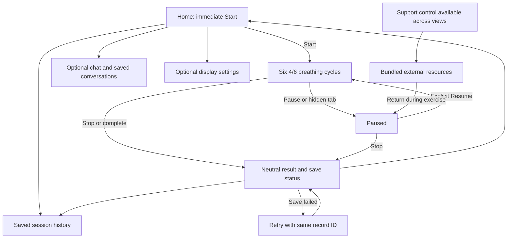

# Breathing Room — final design and implementation

## Purpose, task and scope

Breathing Room provides one complete paced-breathing sequence through a local Vue,
FastAPI and SQLite application. Fictional Alex wants a short exercise during a
busy afternoon, without first describing feelings or configuring an account.
Alex can pause, stop, choose a display, and later inspect the saved activity.
Optional chat explains the reviewed exercise and retrieves factual saved records.

The skill is six cycles of four counts in and six counts out: 60 active seconds.
One skill keeps the sequence intact and the interface small, at the cost of
technique/duration choice. This assignment prototype is not therapy, diagnosis,
monitoring or a public support service. No clinical effectiveness is claimed.

## Final screen flow

Home offers immediate Start, concise duration/stop information, optional Chat and
History, and expandable Display settings. Still-text pacing is the default;
moving-circle pacing and larger text are explicit choices. Show fewer options
collapses display settings; it does not hide the primary navigation or support.

The exercise presents one instruction and count, cycle/remaining-time context,
Pause, Stop, a display switch and persistent Crisis support. Pause freezes the
current phase; Resume is deliberate. Opening support or hiding the tab pauses
the exercise. Returning does not resume automatically. Stop exits immediately,
even if a model request or save has not finished.

The terminal view says Finished or Stopped, shows factual activity and save
status, and offers home/history. No rating, streak or claim of improvement is
required. Failed persistence is visible and retryable. There is no forced timeout
on a paused, support or terminal view.

Support information is bundled with the frontend and does not need the backend,
provider, classifier or a questionnaire to open. External resources still need
their ordinary telephone/network connection. Region labels identify the United
States and territories; resource details were checked November 2, 2026. No service
was contacted during evaluation.

## Research-to-design rationale

R1–R4 and D1–D6 below paraphrase the supplied assignment research table. They are
design inputs, not independent efficacy findings or a claim that this prototype
has been clinically validated.

| Finding | Implemented decision and reason | Tradeoff and evidence |
| --- | --- | --- |
| R1: attention declines beyond 90–100 seconds | A fixed 60-active-second sequence avoids a lengthy interaction. | Duration is not adjustable. S01 measured 60.321s originally and 66.985s on final rerun, both below 90s including observed UI delay. |
| R2: frictionless crisis access | A shared, labeled control opens bundled support independently. | Takes persistent screen space; B1 checks access across interruptions/failures. |
| R3: permission to stop | Pause and Stop remain available, with neutral stopped records. | Stopping establishes activity only; S02–S04/S18 check exits. |
| R4: user controls the journey | Explicit Start, optional chat, reversible/resettable display choices. | One technique limits choice; no model-driven routing. S07 checks restoration/reset. |
| D1: less content when needed | Sparse exercise and explicitly collapsible Display settings. | Requires a deliberate choice, not inferred distress. Navigation/support remain discoverable. |
| D2: one atomic action | Only the current inhale/exhale instruction is primary. | Essential controls remain visible; timing tests check phase/count transitions. |
| D3: reduce emotional effort | No required typing, questionnaire, mood score or post-session rating. | No subjective outcome data; completion cannot establish benefit. |
| D4: persistently visible support | Support lives outside model-dependent components. | External service availability is outside the app; B1 verifies the local route. |
| D5: personalization without setup burden | Save explicit pacing, text-size and settings-visibility choices; offer reset. | Saves interaction preferences, not mental state. S07 and preference race tests check control. |
| D6: quiet, nonjudgmental presentation | Muted blue/ivory, readable text, restrained optional motion and neutral outcomes. | No universally calming palette is claimed; responsive, contrast and motion checks address presentation. |

## Alternatives, state information and changes from Part 1

Conversation-first entry could supply more context, but adds disclosure and model
waiting before the skill. Start-first was selected to reduce effort and preserve
control. A questionnaire or brief check-in would collect subjective information
but add collection/scoring/interpretation demands. Click timing or a pointing task
would add a task with device, motor and practice confounds. None was implemented.
Explicit display choices provide useful personalization without an emotional-state
estimate. No specialist model, external conversation dataset or training was used.

| Information | Example | Permitted interpretation |
| --- | --- | --- |
| Attributed self-report | A fictional chat message says the person feels overwhelmed. | Preserve the statement with role/time; it is not a measured or diagnosed state. |
| Recorded action | A session stopped at 20 active seconds; text display was selected. | Show the event and remember the explicit choice; do not infer why it happened. |
| Unsupported inference | The person stopped because distress increased. | Do not save or present this as a fact, route the person, or infer improvement. |

Missing history yields an honest empty state. A late preference read cannot
replace a newer choice. Apparently conflicting words and actions remain separate
facts; the app does not decide which reveals a hidden emotion. Pause events are
not stored, so a completed session cannot establish uninterrupted participation.

| Part 1 direction or later problem | Final decision | Reason and evidence |
| --- | --- | --- |
| Preference/conversation setup before exercise | Immediate Start; optional settings/chat | R4/D3/D5; S01 requires no setup. |
| Ordinary backend retrieval alone | Two-stage model-proposed SQL RAG with finite validation | Meets the supplied retrieval architecture while keeping writes application-owned. |
| Simplified view would hide chat/history previews | Collapse only Display settings; retain navigation | Reduce clutter without making saved history or chat harder to find. |
| Motion-led visual pacing | Still text by default, optional motion and reduced-motion override | Preserve pacing with less mandatory animation; S07/S09. |
| Initial green palette | Muted blue/ivory | Explicit aesthetic preference and readable contrast, not a clinical claim. |
| Possible active/interrupted recovery and history deletion | Persist terminal stopped/completed sessions; disclose unfinished-refresh loss; no delete action | Keeps outcomes truthful and implementation bounded. S06 verifies no fabricated session. |
| Prompt-only prohibition on pause inference | Narrow fixed reply for recognized past-pause questions | Repeated live wording remained ambiguous; S17 and provider-failure tests verify deterministic wording. |
| Model-generated crisis redirection | Fixed reply for recognized phrases plus unconditional support | Both live repeats gave generic descriptions; fixed rules reduce this known failure without claiming detection. |
| New replies saved but offscreen in long chats | Open the latest message page after Send/open; retain earlier/later navigation | Before/after API IDs and S12 demonstrate the corrected presentation. |

## Architecture and request flow

Vue communicates with FastAPI over HTTP/JSON. App.vue owns views, exercise
lifecycle, session outbox and preferences; breathing.js owns elapsed-time pacing;
api.js owns bounded requests. ChatPanel.vue and SessionHistory.vue show saved
records. Backend models validate input, controllers apply business rules, and
repositories perform parameterized SQLite reads/writes. The database path is
resolved from the project location. Startup adds missing schema without reseeding.

Chat first saves the submitted message with a stable request ID. A recognized
fixed-rule input receives an application reply before provider selection, retrieval
or budget reservation. Other inputs use mock or configured live processing:

1. Send the question, field meanings and permitted query templates to the provider.
2. Validate the proposed SQL against five exact normalized read-only forms: recent,
   completed or stopped sessions; current-conversation messages; explicit preferences.
3. Bind profile/conversation IDs in a read-only SQLite connection with an authorizer,
   query-only mode, a 100ms execution budget, at most five rows and 12,000 serialized
   context characters. A SELECT prefix alone is insufficient validation.
4. Send selected records and reviewed skill context for answer generation. Treat
   stored text as attributed data, require grounded claims and check returned IDs.
5. Save the actual reply transactionally and return its stable IDs, attribution,
   retrieval state and persistence status. A failed request never fabricates a reply.

Live stages have 20-second provider deadlines. Both calls count against a persistent
50-call cap for one demonstration ID; failures/unused reservations count
conservatively. Exhaustion switches to labeled mock output. Successful retries
replay saved messages without another provider call. Provider credentials stay in
the backend; optional live calls transmit only the question and selected fictional
context. Provider `store: false` is not a general retention guarantee.

The narrow fixed rules match explicit crisis substrings and history-related
pause/uninterrupted wording. They can match quotations/negations and miss indirect
language. They are not a classifier, diagnosis or comprehensive safety mechanism.
Valid citation IDs also do not prove the surrounding claim is true.

## Persistence and API contract

| Stored relation | Meaning and limits |
| --- | --- |
| sessions | Stable ID, fixed fictional profile/skill/version, UTC start/end, stopped/completed, active seconds, completed cycles and final display. No pause events or emotional outcome. |
| conversations / messages | Stable conversation/message/request IDs, sequence, role, content and timestamps; replies retain provider/model, retrieval state and cited IDs. Attributed content is not verified clinical fact. |
| chat_requests | Request state, attempts and lease support retry/replay and prevent duplicate user/assistant pairs. Expired 90-second attempts become retryable. |
| preferences | Explicit mode, simple setting and text size; no inferred-state field. |
| provider_usage | Persistent reservations by demonstration ID, including both live stages. |

| Method and application path | Validated input | Success |
| --- | --- | --- |
| GET /api/health | None | Status, storage/configuration presence, provider mode and reserved-call count; no secret values. |
| PUT /api/sessions/{id} | UUID; aware start/end; 0–60 active seconds; 0–6 cycles; stopped/completed; text/motion | Saved session with stable ID and fictional attribution. Identical retry replays; conflicting reuse returns 409. |
| GET /api/sessions | limit 1–100, offset 0–100000 | Sessions ordered by start time then ID descending, with pagination fields. |
| PUT /api/conversations/{id}/messages/{request_id} | UUIDs and trimmed content of 1–1000 characters | Saved exchange, provider attribution and budget-fallback flag. |
| GET /api/conversations | limit/offset | Ordered conversation summaries with IDs/timestamps. |
| GET /api/conversations/{id} | limit/offset; optional latest=true | Ordered messages, total and effective offset. Latest page handles exact page boundaries. |
| GET /api/preferences | None | Saved/default explicit preferences. |
| PUT /api/preferences | text/motion, simple boolean, standard/large | Persisted choices and saved status. |

Errors use an error code/message envelope; invalid input is 422, ID conflict 409,
and storage/provider failures use explicit failure responses. Health is the exception:
storage failure returns its typed unavailable body with HTTP 503. Error responses
do not disclose credentials, submitted content or database paths. Local OpenAPI at
`/docs` describes the typed current contract.

Session validation requires active duration to fit within wall timestamps, cycles
to equal floor(active seconds / 10), and completion to mean exactly 60 seconds/six
cycles. These are validated client measurements, not independent proof of elapsed
time. For example, 20 active seconds within 25 wall seconds is a stopped two-cycle
session; retrying its unchanged UUID produces one row. History shows those facts
without inferring the reason for the five-second difference.

## Timing, presentation and sources

The 90-second boundary is measured from first visible instruction to visible
Finished, including observed rendering/scheduling delays. Entry and Start overhead
are reported separately. Voluntary pauses/support visits are outside the active
sequence and are never forcibly ended. The final rerun measured 66.985 seconds;
the original run measured 60.321 seconds. Both saved 60 active seconds/six cycles.
The slower rerun exceeded the original 60–65-second planning estimate but remained
within the assignment's 90-second requirement. See [evaluation](part3/evaluation.md).

Presentation uses 18px base text with a 20px choice, visible focus, optional motion,
and responsive stacking. Previously calculated contrast ratios include body text
10.90:1, secondary text 5.18:1 and button text 5.61:1. Narrow viewport, text spacing
and keyboard tests passed; these do not establish complete accessibility conformance.

Sources informing the design include the supplied assignment research table and
user-state ideation material, plus W3C guidance on [manageable content](https://www.w3.org/WAI/WCAG2/supplemental/patterns/o5p03-manageable-quantity/),
[clear words](https://www.w3.org/WAI/WCAG2/supplemental/patterns/o3p01-clear-words/),
[contrast](https://www.w3.org/WAI/WCAG22/Understanding/contrast-minimum.html),
[animation](https://www.w3.org/WAI/WCAG22/Understanding/animation-from-interactions.html),
and [text spacing](https://www.w3.org/WAI/WCAG22/Understanding/text-spacing.html).
The supplied Macaulay/Austin summaries informed the state-information discussion;
their original papers were not separately evaluated in that revision. No questionnaire
items, dataset examples or clinical population findings are reproduced as app evidence.

[Wilms and Oberfeld](https://pubmed.ncbi.nlm.nih.gov/28612080/) and
[Jonauskaite and Mohr](https://link.springer.com/article/10.3758/s13423-024-02615-z)
informed the earlier palette exploration, not a claim that these exact colors reduce
anxiety. The selected palette reflects explicit preference and contrast checking.
The provider integration followed the official [Responses text guide](https://developers.openai.com/api/docs/guides/text)
and [structured-output guide](https://developers.openai.com/api/docs/guides/structured-outputs).
`gpt-4.1-mini` identifies the tested configurable alias, not clinical suitability
or a recommendation that it is the newest model. No prior Expedia source was copied.

## Evidence and remaining boundaries

See [requirements coverage](part3/requirements.md), [verification](verification.md),
[evaluation](part3/evaluation.md) and [AI disclosure](../AI-USE.md). Tests establish
observed software behavior, not reduced distress. Full screen-reader speech, native
zoom, actual OS reduced-motion changes and another OS remain untested. Active refresh
is disclosed as unsaved; closing a tab can lose pending retries. The app remains
single-profile and local, with no authentication, deletion interface or public deployment.
